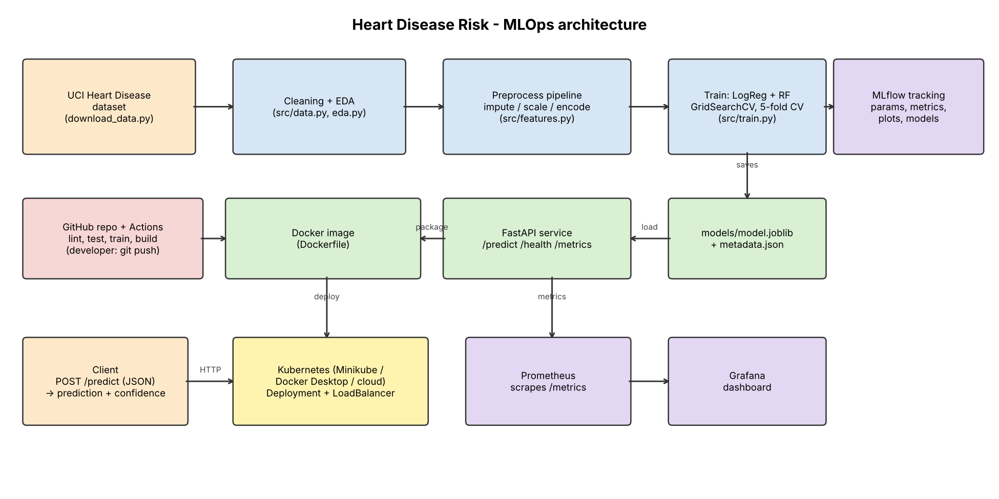

# Heart Disease Risk Prediction – End-to-End MLOps

Binary classifier (heart disease present / absent) built on the UCI Heart Disease (Cleveland) dataset, with
experiment tracking (MLflow), reproducible pipeline, unit tests, GitHub Actions CI/CD, Docker, Kubernetes deployment
and Prometheus/Grafana monitoring.

> Course: MLOps (AIMLCZG523) – Assignment 1. **Full walkthrough: [GUIDE.md](GUIDE.md)**.

## Architecture



## Quick start

```bash
python -m venv .venv && source .venv/bin/activate        # Windows: .venv\Scripts\Activate.ps1
pip install -r requirements-dev.txt
python scripts/download_data.py        # dataset -> data/raw, data/processed
python -m src.eda                      # figures -> reports/figures
python -m src.train                    # train + MLflow tracking + save models/model.joblib
mlflow ui --backend-store-uri sqlite:///mlflow.db      # http://localhost:5000
pytest --cov=src && flake8 src tests scripts
uvicorn src.api:app --port 8000        # http://localhost:8000/docs
```

## Run it (access instructions)

```bash
# Docker
docker build -t heart-disease-api .
docker run -d -p 8000:8000 --name heart-api heart-disease-api
curl -X POST http://localhost:8000/predict -H "Content-Type: application/json" \
  -d '{"age":63,"sex":1,"cp":1,"trestbps":145,"chol":233,"fbs":1,"restecg":2,"thalach":150,"exang":0,"oldpeak":2.3,"slope":3,"ca":0,"thal":6}'

# Monitoring stack (API + Prometheus + Grafana)
docker compose up --build -d     # Grafana http://localhost:3000 (admin/admin)

# Kubernetes (Minikube or Docker Desktop)
kubectl apply -f k8s/deployment.yaml -f k8s/service.yaml
```

## API

| Endpoint | Method | Purpose |
|---|---|---|
| `/predict` | POST | JSON patient features → `prediction` (0/1), `label`, `confidence`, `probability_disease` |
| `/health` | GET | liveness/readiness, model status |
| `/metrics` | GET | Prometheus metrics (request count/latency, predictions by class, confidence) |
| `/docs` | GET | Swagger UI |

Input fields: `age, sex, cp, trestbps, chol, fbs, restecg, thalach, exang, oldpeak, slope` (required),
`ca, thal` (optional – imputed if missing). Invalid input → HTTP 422.

## Repository layout

```
src/          data.py  features.py  eda.py  train.py  predict.py  api.py  logging_config.py  config.py
scripts/      download_data.py  load_test.py  smoke_test.sh
tests/        test_data.py  test_features.py  test_model.py  test_api.py
notebooks/    01_eda  02_model_training  03_inference
k8s/          deployment  service  ingress  hpa  monitoring
monitoring/   prometheus.yml  grafana/provisioning (datasource + dashboard)
.github/workflows/ci.yml        Dockerfile        docker-compose.yml
data/  models/  reports/  screenshots/
```

## Design notes

* **No leakage:** imputation, scaling and encoding live inside one sklearn `Pipeline`; it is fit only on training folds
  and shipped with the model, so the API accepts raw feature values.
* **Model selection** uses 5-fold CV ROC-AUC on the training split; the hold-out test set is only used for reporting.
* **Tracking:** every run logs params, CV + test metrics, plots, the MLflow model and the dataset.
* **CI/CD:** flake8 → pytest (+coverage) → train → artifacts → Docker build + smoke test → push to GHCR.
* Educational model, **not** a medical device.

## Dataset

UCI Machine Learning Repository, Heart Disease (id 45) – Cleveland subset, 303 patients.
Janosi, Steinbrunn, Pfisterer, Detrano. https://archive.ics.uci.edu/dataset/45/heart+disease
